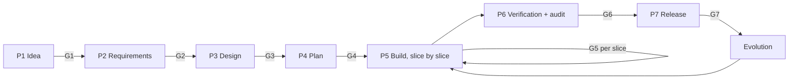
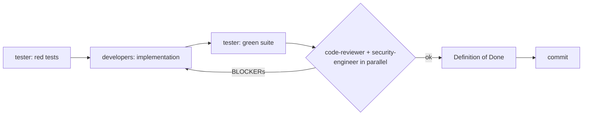

# Bottega: a software development team for Claude Code

**Bottega** is a Claude Code plugin that provides a team of specialist agents and a set of skills to take an application **from idea to deployment**: requirements, decisions, architecture, database, code, tests, code review, security and release.

The name comes from the Renaissance *bottega*, the workshop where a master (you, with the orchestrator) and specialized apprentices work on the same piece under shared rules.

## Principles

1. **You decide; the team helps you decide.** Every significant choice reaches you with options, trade-offs and a recommendation, and is recorded as an ADR.
2. **Interaction in skills, work in agents.** Phases that need a conversation with you (idea, requirements, decisions, approvals) run in the main conversation. Specialist work runs in subagents with isolated context, so reviews are independent and the main context stays lean.
3. **Gates, not hopes.** Every phase ends with a verifiable gate and your approval.
4. **Tests first, then code.** Every acceptance criterion becomes a test that fails before the implementation exists.
5. **Mandatory security, on three levels:**
   - *Process:* security requirements in P2, a threat model in P3, a security review of every slice, and an audit before release. No security gate can be skipped.
   - *Standard:* [`references/security-standard.md`](references/security-standard.md), based on OWASP ASVS L2 plus GDPR. [MUST] rules allow no exceptions, and CRITICAL and HIGH findings can never be accepted.
   - *Deterministic hooks:* they block secrets in files and commands and insecure commands, and ask for confirmation before deploys, pushes and destructive actions, regardless of what the model "decides".
6. **Evidence rule.** Nothing is "done" without fresh command output.
7. **Traceability.** FR → US → AC → slice → test → code → finding, with stable IDs.

## The team

| Agent | Role | Model | Can change code? |
|---|---|---|---|
| `product-analyst` | Vision, FR, NFR and SR requirements, user stories, acceptance criteria | opus | no (docs only) |
| `critic` | Devil's advocate on vision, requirements, architecture and plan | opus | no (read-only) |
| `architect` | Architecture, stack, C4, ADRs | opus | no (docs only) |
| `data-architect` | Data model, schema, indexes, migrations, data privacy | opus | yes (migrations) |
| `ux-designer` | Flows, screens, states, accessibility | sonnet | no (docs only) |
| `tech-lead` | Modules, contracts, vertical slices, traceability, impact analysis | opus | no (docs only) |
| `backend-developer` | APIs, domain, data, integrations | sonnet | yes |
| `frontend-developer` | UI, components, state, accessibility | sonnet | yes |
| `tester` | Test strategy, test-first, verification, e2e, regression | sonnet | tests only |
| `code-reviewer` | Independent code review | opus | no (report only) |
| `security-engineer` | STRIDE threat model, security review, audit, veto power | opus | no (reports and threat model only) |
| `devops` | Local environment, CI/CD, hosting, IaC, observability, deployment | sonnet | yes (infrastructure) |

## The flow



The cycle of every slice (`/bottega:build`):



## Commands

| Command | Purpose |
|---|---|
| `/bottega:start [idea]` | **Entry point.** Orchestrator: guides every phase or resumes the current one |
| `/bottega:setup` | Creates `docs/` and `STATUS.md` in the project, prepares git and `.gitignore` |
| `/bottega:idea` | Discovery interview → vision and MVP |
| `/bottega:requirements` | Guided requirements elicitation → FR, NFR, SR, US, AC |
| `/bottega:decide <decision>` | Structured decision with weighted criteria → ADR |
| `/bottega:design` | UX, architecture, data, threat model |
| `/bottega:plan` | Vertical slices, contracts, test strategy |
| `/bottega:build [SL-NN]` | Full cycle of one slice |
| `/bottega:review [scope]` | On-demand code review and security review |
| `/bottega:security-audit` | Full security audit with a release verdict |
| `/bottega:release` | Hosting choice, pipeline, staging, production (only when you ask) |
| `/bottega:status` | Project dashboard and next step |
| `/bottega:evolve <change>` | Change request on an existing project |

You can also call an agent directly: `@agent-bottega:critic review docs/04-architecture.md`.

The orchestrator talks to you in the language you write in. The project documents in `docs/` are written in English.

## Installation

Requires **Python 3** (used by the hooks). For audits, `gitleaks`, `semgrep`, `trivy` and `osv-scanner` are recommended: `/bottega:setup` checks which ones are missing.

**To install it** from GitHub (the repository doubles as a plugin marketplace):
```bash
claude plugin marketplace add mrclttnz/bottega-sw-dev-agents
claude plugin install bottega@bottega-local
```

**To work from a local clone** (to try it or to customize it), clone the repository wherever you like:
```bash
git clone https://github.com/mrclttnz/bottega-sw-dev-agents.git
```

Then either load it for a single session, without installing anything, by running Claude Code from your application's folder:
```bash
claude --plugin-dir <path-to>/bottega-sw-dev-agents
```

or install it from the clone, so your local changes are the ones in use:
```bash
claude plugin marketplace add <path-to>/bottega-sw-dev-agents
claude plugin install bottega@bottega-local
```
Replace `<path-to>` with the folder where you cloned the repository. After changing the plugin's files, reload it from `/plugin`, or restart the session.

## What you'll find in your project

```
my-app/
├── docs/
│   ├── STATUS.md             phase, gates, slices, technical debt, log
│   ├── 01-vision.md
│   ├── 02-requirements.md
│   ├── 03-ux.md
│   ├── 04-architecture.md
│   ├── 05-data.md
│   ├── 06-threat-model.md
│   ├── 07-plan.md
│   ├── 08-test-strategy.md
│   ├── 09-release.md
│   ├── adr/ADR-0001-….md
│   └── reviews/SL-01-code.md, SL-01-security.md, audit-….md
└── … the code
```

`docs/` is the team's memory: every new session picks up from there. A `SessionStart` hook reminds Claude of the current phase.

## Plugin structure

```
.claude-plugin/        plugin.json, marketplace.json
agents/                the 12 specialist agents
skills/                the 13 skills (orchestrator and phases)
references/            shared rules: protocol, security standard, review contract
templates/             project document templates
hooks/hooks.json       security and context hooks
scripts/               hook implementations (Python, standard library only)
tests/                 hook tests
```

## Customization

- **Models:** change `model:` in an agent's frontmatter (`opus`, `sonnet`, `haiku`, `inherit`).
- **Security standard:** edit `references/security-standard.md`. Every agent reads it on every invocation.
- **Language standards:** edit `references/python-standard.md`. The backend developer, tester, reviewer, tech lead and DevOps read it when the stack includes Python. Tag each rule [BLOCKER] or [FIX-IN-SLICE] to set the class of its violations; untagged rules are recommendations.
- **Hooks:** add patterns to `scripts/guard_commands.py` or `scripts/secret_patterns.py`, add a test to `tests/test_guards.py`, and run the tests.
- **New agent:** create `agents/<name>.md` following the structure of the others (protocol reference, what it produces, how it works, final report), and reference it from the phase skill that uses it.

## Developing the plugin

```bash
python3 -m unittest discover -s tests -v   # hook tests
claude plugin validate .                    # manifest validation
```

## Known limitations

- The hooks are a **safety net**, not a guarantee: the patterns cover common cases, but an obfuscated command can slip through. The main defense remains the process (reviews, audits) with real scanners.
- Subagents can't ask questions, so decisions always go through the orchestrator. This is intentional: it keeps you at the center.
- The plugin coordinates and verifies, but the quality of the requirements depends on the answers you give in the interviews.

## Inspiration

The idea of roles that collaborate through shared files, with gates between phases, is inspired by [10x-Team](https://github.com/Jaan-Mustafa/10x-Team) and [dev-team](https://github.com/biggora/dev-team). Bottega's structure, roles, rules and content are original.
