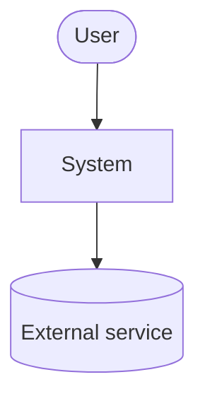
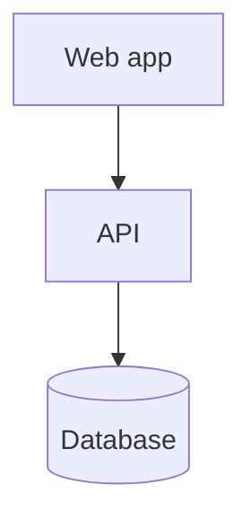
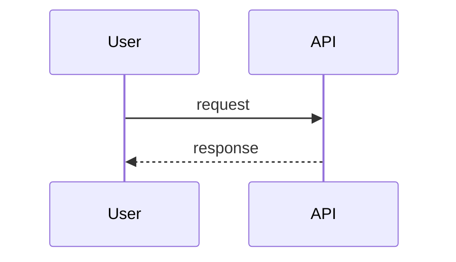

# Architecture

## Architectural drivers
| Driver (NFR / SR / constraint) | Implication |
|---|---|

## Context (C4 level 1)

## Containers (C4 level 2)

## Components and responsibilities
| Component | Responsibility | Interfaces | Technology |
|---|---|---|---|

## Technology stack
| Layer | Choice | Version | ADR |
|---|---|---|---|

## Key flows

## Trust boundaries
## Cross-cutting strategies
- Configuration and secrets:
- Logging and observability:
- Error handling:
- Authentication and authorization:
- Caching:
- Internationalization:

## Requirements → solutions map
| ID | How it is satisfied |
|---|---|

## Architectural risks
| Risk | Likelihood | Impact | Mitigation |
|---|---|---|---|
