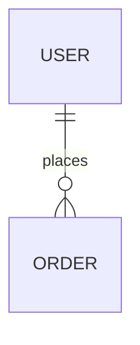

# Data model

## Conceptual model

## Schema
### <table>
| Field | Type | Null | Default | Constraints | Notes |
|---|---|---|---|---|---|

## Indexes
| Table | Index | Rationale (query / requirement) |
|---|---|---|

## Critical queries
## Data classification
| Field | Class (public / internal / personal / special category) | Purpose | Retention | Field-level encryption | Masked in logs |
|---|---|---|---|---|---|

## Migrations
- Tool:
- Conventions:
- Reversibility and zero-downtime:

## Integrity and concurrency
## Backup, restore and retention
- RPO / RTO:
- Right to erasure:

## Database users and privileges
| User | Purpose | Privileges |
|---|---|---|

## Seed and test data
