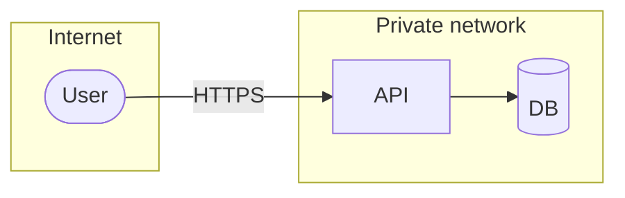

# Threat model

## Assets
| Asset | Value | Data class |
|---|---|---|

## Threat actors
## Data flow and trust boundaries

## Attack surface
| Entry point | Authentication | Notes |
|---|---|---|

## Threats (STRIDE)
| ID | Category | Component | Threat | Likelihood | Impact | Risk | Mitigation | SR / Slice | Verified by test |
|---|---|---|---|---|---|---|---|---|---|
| THR-001 | Spoofing | Login | Credential stuffing | H | H | High | Rate limit + MFA + breached-password check | SR-002 / SL-01 | – |

## Proposed security requirements
## Mandatory pipeline controls
- Secret scanning:
- SAST:
- Dependencies:
- Containers / IaC:
